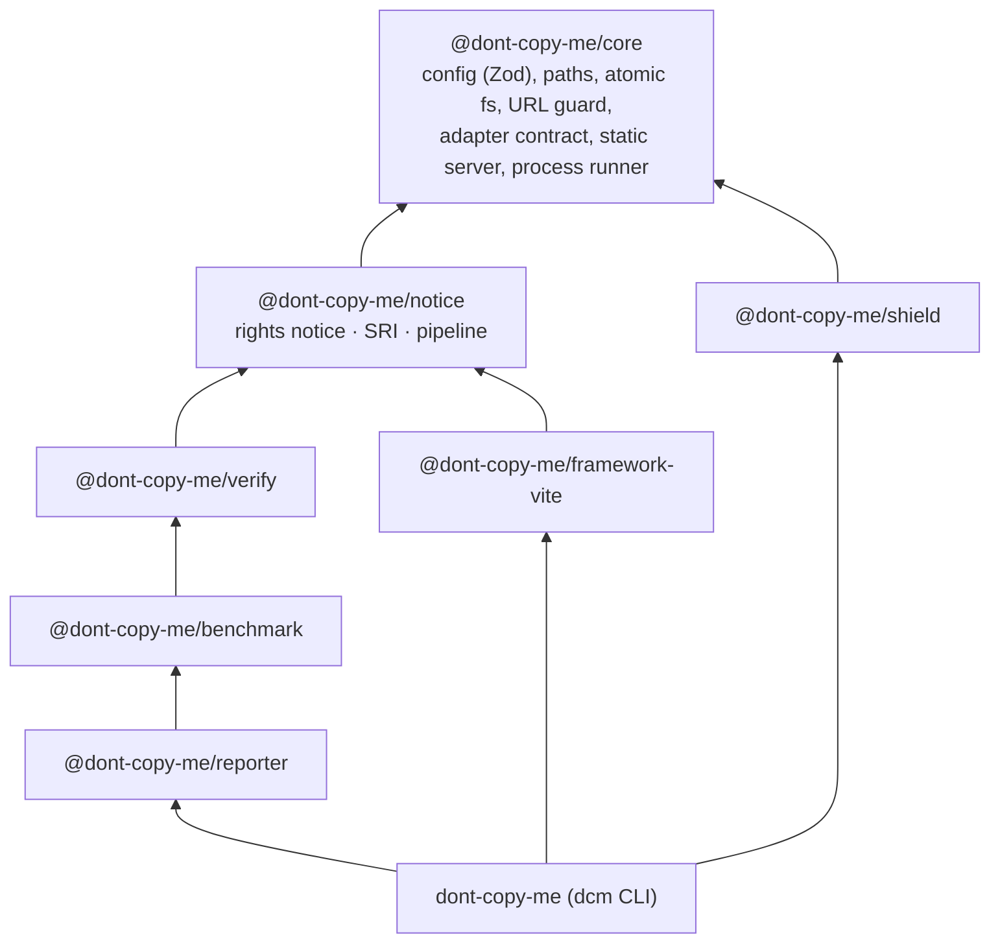
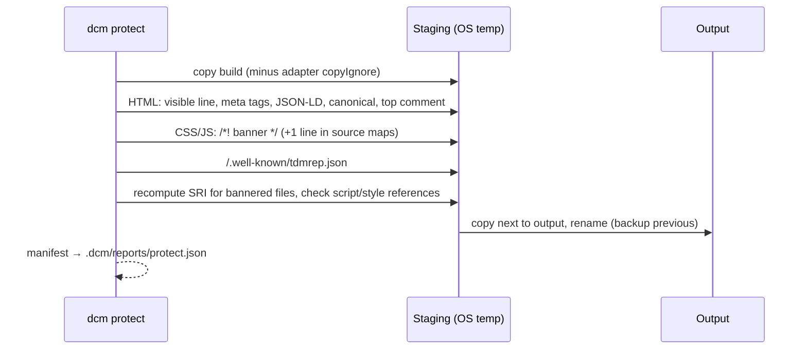

# Architecture

## Packages and dependency direction

There are no cycles. Only `cli` composes everything. Framework adapters are injected
(`resolveProject(root, config, adapters)`), and clone runners implement `CloneRunner`.

## The protect pipeline

Key properties:

- **Separate output.** The input build and sources are read-only to dcm. The output may not overlap
  the input, the project root or source directories.
- **Atomic publish.** Work happens in `os.tmpdir()`. The finished tree is copied next to the output
  and swapped in with `rename`. The previous output goes to `.dcm/backups/` (3 kept), and
  `dcm rollback` restores it. A broken reference aborts before publishing.
- **Idempotent.** Pages that already carry `data-dcm-rights` and files that already start with the
  banner are left alone. The same input and config produce the same output.
- **One text everywhere.** `renderNotice` produces the notice once; every placement uses it. The
  code banner adds the original site and a third-party license sentence.

## Verification

`verifyBuilds` serves both builds and compares them per viewport:

- the rights notice is present on every HTML page of the output;
- HTTP status, title and rendered text;
- new console, page, network and hydration errors;
- full-page screenshots with animations frozen (the notice line is removed before comparing);
- accessibility smoke checks (no regressions allowed);
- scripted flows (`verify.flows`);
- median cold-load metrics and CDP script time, against budgets.

## Benchmark

`runCloneBenchmark`: per runner, per trial, per side (without / with notice): a fresh loopback
server (server-side request log), a fresh temp working directory, the runner (`runIsolated`: no
shell, timeout with process-group kill, `time(1)` accounting, optional `sandbox-exec`), artifact
capture, then offline evaluation against cached captures of the original. For AI runners,
`StreamUsageCollector` reads the agent's stream-json transcript: usage, and
`classifyNoticeResponse` for mentions and refusals.
