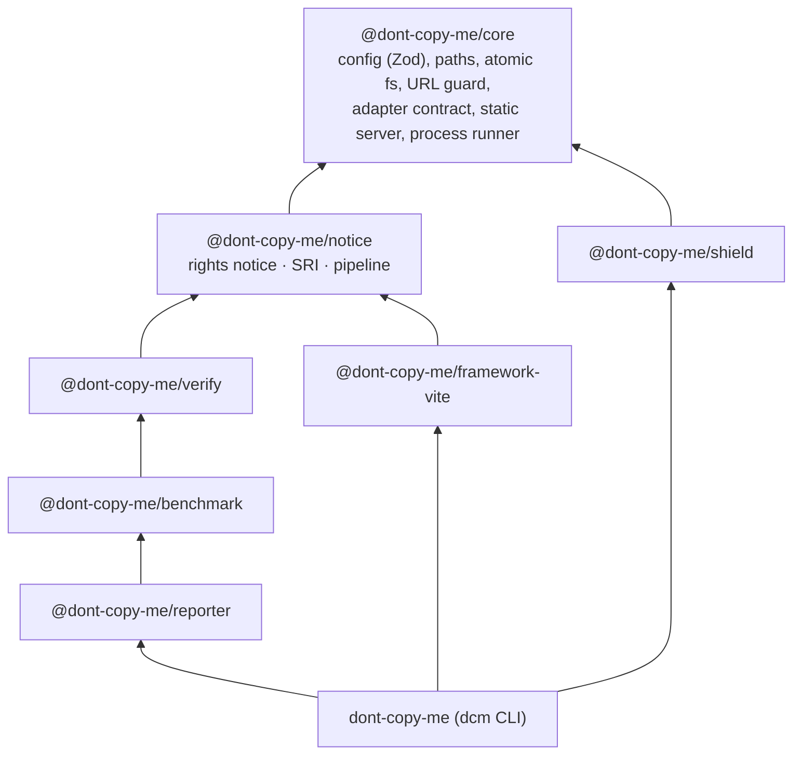
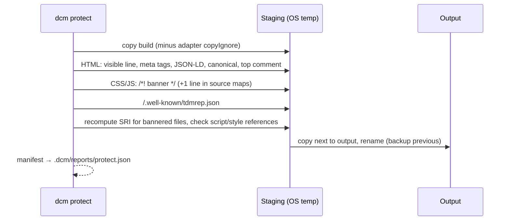

# Architecture

## Packages and dependency direction

- There are no cycles.
- Only `cli` puts all packages together.
- The caller injects framework adapters: `resolveProject(root, config, adapters)`.
- Clone runners implement `CloneRunner`.

## The protect pipeline

Key properties:

| Property | What it means |
|---|---|
| **Separate output** | dcm only reads the input build and the sources. The output must not overlap the input, the project root or the source directories. |
| **Atomic publish** | dcm does the work in `os.tmpdir()`. It copies the finished tree next to the output and swaps it in with `rename`. The previous output goes to `.dcm/backups/` (dcm keeps 3). `dcm rollback` restores it. A broken reference stops the run before dcm publishes. |
| **Idempotent** | dcm does not change pages that already have `data-dcm-rights`, or files that already start with the banner. The same input and config give the same output. |
| **One text everywhere** | `renderNotice` makes the notice one time. All placements use it. The code banner adds the original site and a third-party license sentence. |

## Verification

`verifyBuilds` serves both builds. It compares them for each viewport and checks:

- The rights notice is on every HTML page of the output.
- HTTP status, title and rendered text.
- New console, page, network and hydration errors.
- Full-page screenshots, with animations frozen. dcm removes the notice line before it compares them.
- Accessibility smoke checks. dcm allows no regressions.
- Scripted flows (`verify.flows`).
- Median cold-load metrics and CDP script time, against budgets.

## Benchmark

`runCloneBenchmark` repeats these steps for each runner, each trial and each side (without and with the notice):

1. Start a new loopback server. The server keeps a request log.
2. Make a new temp working directory.
3. Run the runner with `runIsolated`. It uses no shell, kills the process group on timeout, records resources with `time(1)`, and can use `sandbox-exec`.
4. Capture the artifacts.
5. Evaluate them offline against cached captures of the original.

For AI runners, `StreamUsageCollector` reads the stream-json transcript of the agent. It records usage. It uses `classifyNoticeResponse` to find mentions of the notice and refusals.

For details, see [benchmark.md](benchmark.md).
